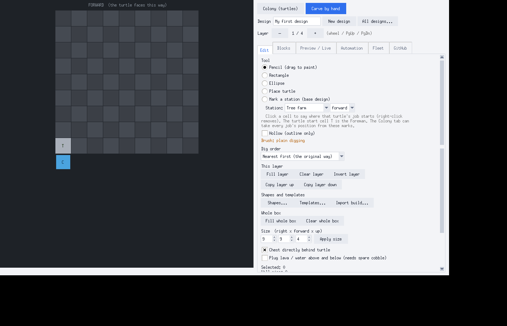

# Carve Designer

Design a dig shape on your PC, put the turtle program on GitHub, and watch your
[CC: Tweaked](https://tweaked.cc) turtles work. It also runs a whole "colony" of turtles: a **Foreman** that
crafts and starts the others from one chest of materials, tree farms, smelters, crafters, miners, scouts,
haulers and a self-building storage warehouse, all visible on a live web page.

It is one Python file (`carve_designer.py`, Python 3.8+ with tkinter, nothing else to install).



## Why this exists (and why it was made with AI)

I made this because I'm bad at coding. I don't have the skills to write something like this myself, so I
used an AI (Claude, by Anthropic) to write it while I told it what I wanted, tested it in my own Minecraft
world and reported what broke. Every feature here started as me saying "can you make it do X" and then
playing with the result.

That means the code works for the things I have tried, but it was not written by a professional and it has
rough edges. I'm making it open source so people who actually know what they are doing can fix it, clean it
up and add what they want. If you can code, you are very welcome here.

## What it does

* **Dig designer**: click cells layer by layer to say what a mining turtle should dig; shapes, templates,
  schematic import, an estimate of fuel and time, a 3D preview and a live view of the real turtle.
* **Automation programs** that keep running: tree farm, auto smelter (splits work over all furnaces,
  prefers charcoal as fuel), auto crafter, miner, scout, hauler, storage keeper.
* **Colony / Foreman**: put the materials in a chest next to one hand-crafted turtle and it crafts, boots, equips and
  sends out all the others (see the shopping list in the Colony tab).
* **Fleet web page** (`http://127.0.0.1:8765`): turtles, 2D and 3D map, storage contents, and the Foreman's
  inventory and crafting queue, with item pictures.
* **GitHub upload**: your designs and turtle programs go to your own repository; on a turtle you run `carve`
  and pick one.

More screenshots are in `docs/images/`.

## Quick start

```
python carve_designer.py
```

1. Make the designs or pick the Colony tab.
2. In the GitHub tab, give it a repository and a token (a token is only saved on your computer if you tick the box).
3. Press Upload, copy the one-line install command it shows and paste it into a turtle.

In-game you need CC: Tweaked with `http` allowed to reach your computer (for a single-player world the turtle reaches the
app at `http://127.0.0.1:8765`; you may have to allow that address in the mod's HTTP rules).

## Repository layout

| Path | What is in it |
| --- | --- |
| `src/p*.py` | The Python app, in numbered parts (model, icons, simulator, fleet server, GitHub, GUI). |
| `src/auto_*.lua`, `launcher.lua`, `turtle_job.lua` | The programs that run **on the turtles**. |
| `src/fleet.html`, `viewer3d.html`, `turtle3d.js` | The web pages the app serves. |
| `build.py` | Glues `src/` together into the single file `carve_designer.py`. |
| `carve_designer.py` | The built, ready-to-run program (commit it after every build). |
| `tests/` | A full test suite, including a mock turtle that runs the Lua programs. |
| `CHANGELOG.md` | What changed in which version. |

## Building and testing

```
python build.py                       # rebuilds carve_designer.py from src/
pip install lupa pillow
xvfb-run -a -s "-screen 0 1400x900x24" python tests/run_tests.py     # Linux; on Windows/macOS run it without xvfb-run
```

Do **not** edit `carve_designer.py` directly: edit `src/` and run `python build.py`.
Every change that is worth a version bumps `VERSION` in `src/p1_core.py` (see CONTRIBUTING.md).

## Known limits

* Tested in a real game by one person, in the single-player CurseForge "Turtle mania" modpack (NeoForge). Some behaviour is
  specific to that pack (a turtle can only craft when its inventory outside the grid is empty; dropping items into a disk drive
  or another turtle does not insert them). The test suite mimics those rules, but other packs may differ.
* The turtle programs are only as good as the mock they are tested against. Bug reports with a screenshot of the
  turtle's screen are the most useful thing you can send.

## Credits and legal

* Built with [Claude](https://www.anthropic.com/claude) (Anthropic) under the direction of the repository owner.
* three.js (MIT) is bundled to make the 3D pages work offline.
* Not affiliated with Mojang, Microsoft, CC: Tweaked or any modpack. Item pictures are drawn by the program from a few
  measured colours; no Minecraft textures are included. Textures you import stay on your own computer.

Licensed under the MIT License (see `LICENSE`).
